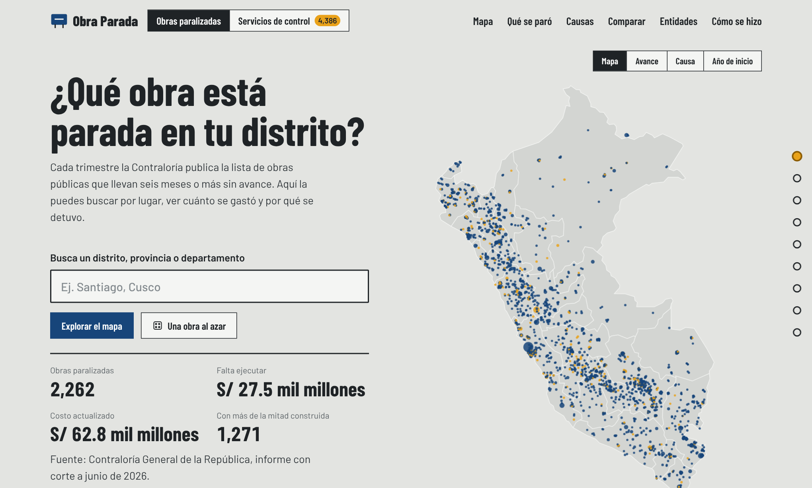
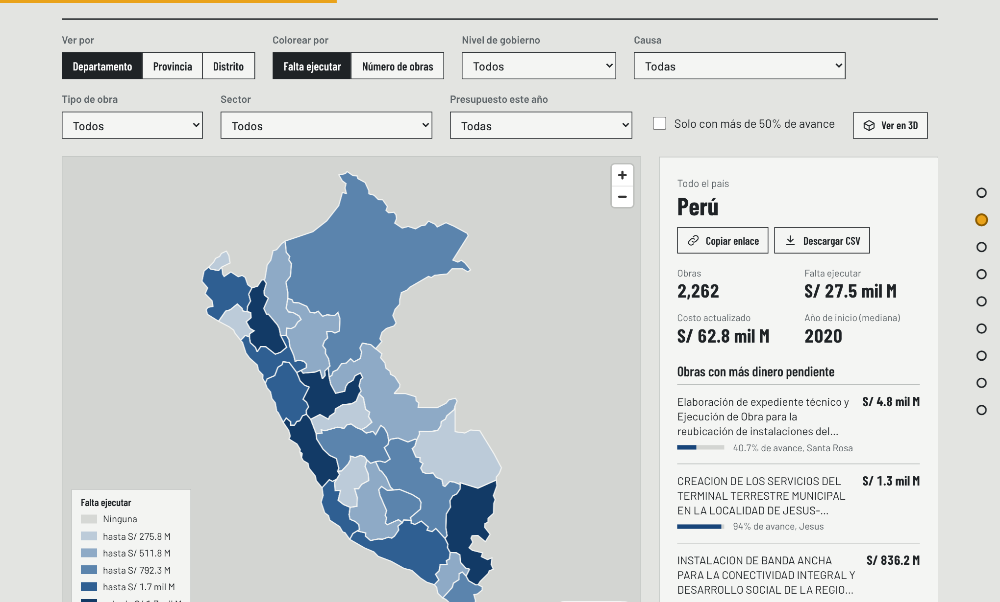
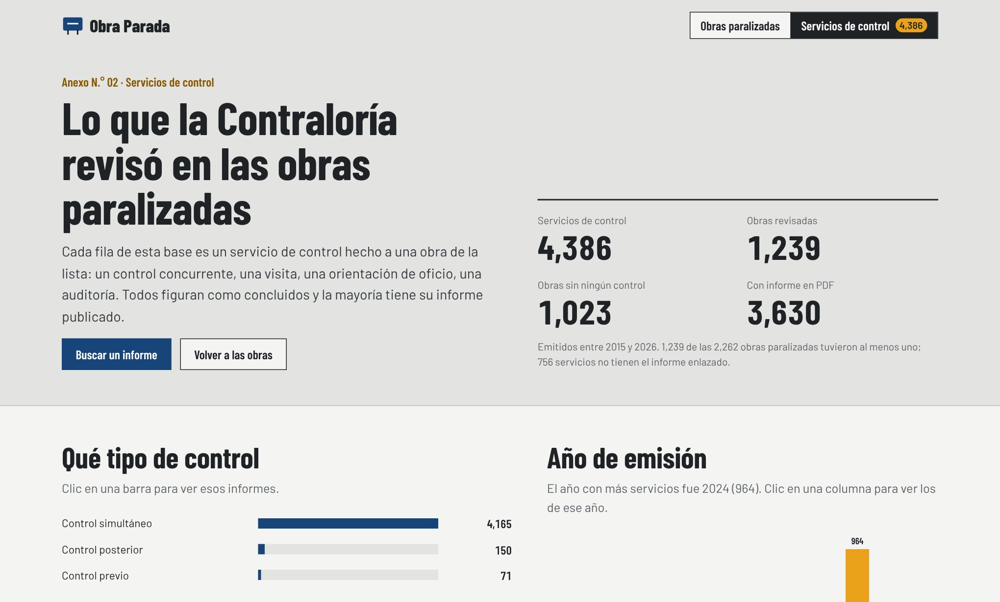
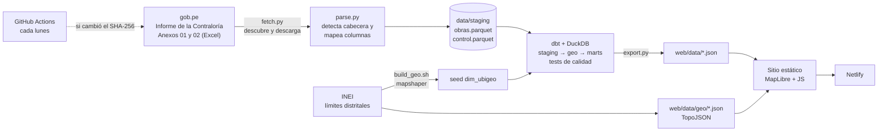

# Obra Parada

Mapa interactivo de las obras públicas paralizadas en el Perú. Buscas tu distrito y ves qué obras están detenidas, cuánto costaron, cuánto falta ejecutar, por qué se pararon y qué revisó la Contraloría en cada una.

Usa las dos bases del informe de la Contraloría a junio de 2026: **2,262 obras paralizadas** (Anexo N.° 01) con S/ 62.8 mil millones de costo actualizado y S/ 27.5 mil millones por ejecutar, y **4,386 servicios de control** hechos a 1,239 de ellas (Anexo N.° 02).

**Demo:** _pendiente de publicar en Netlify_




## El problema

La Contraloría publica cada trimestre el *Informe de obras paralizadas en el territorio nacional*. Según el último informe, a junio de 2026 hay 2,262 obras paralizadas y el 65% se quedó con más de la mitad del avance físico ([Gestión, ago. 2026](https://gestion.pe/economia/hay-mas-obras-paralizadas-con-esta-caracteristica-que-esperar-ahora-con-el-nino-este-es-el-reto-del-gobierno-de-keiko-fujimori-noticia/)).

El dato es público, pero viene en un PDF de 70+ páginas y dos Excel anexos que cambian de formato entre informes. Para saber qué está parado en tu distrito tienes que descargarlo, filtrarlo a mano y saber leer un ubigeo. Esto lo resuelve en una búsqueda.

## Qué se puede hacer

- **Buscar un lugar** (distrito, provincia o departamento) y ver sus obras ordenadas por dinero pendiente.
- **Mapa coroplético** en tres niveles, coloreado por saldo por ejecutar o por número de obras.
- **Filtrar** por nivel de gobierno, causa de paralización, tipo de obra, sector, si tiene presupuesto asignado este año y obras con más de 50% de avance. Todo lo de la página se recalcula con los filtros.
- **Ficha de cada obra** con entidad, ubicación, costo, avance, año de inicio, causa, tipo, presupuesto del año (PIM), si está en la lista priorizada (con enlace a la resolución), informe de estado situacional, código Infobras, CUI y cuántos servicios de control tuvo, con un botón que lleva a sus informes.
- **Servicios de control (pestaña aparte):** los 4,386 servicios del Anexo N.° 02 por tipo de control, tipo de acción, año y órgano que lo hizo; las obras más revisadas; las obras con más dinero pendiente que nunca tuvieron un control; y un buscador de informes por texto, departamento, tipo y año, con enlace al PDF en el sistema de la Contraloría.
- **"A un paso de terminar":** obras con 90%+ de avance, las más baratas de destrabar.
- **Ranking de entidades** por dinero pendiente.
- **Qué se dejó de construir:** los tipos de obra de la clasificación oficial (transporte terrestre, saneamiento, educación, atención médica, riego…). Cada tipo muestra cuántas obras hay, cuánto falta y su avance mediano; es también un filtro del mapa.
- **Récords:** la obra con más dinero pendiente, la más antigua, la que se paró casi terminada, la que tuvo más servicios de control, la entidad y el distrito con más obras, el departamento con más dinero parado.
- **Cuándo empezaron:** obras (o dinero) por año de inicio.
- **Quién las ejecuta:** porcentaje de obras frente a porcentaje de dinero por nivel de gobierno, y una tabla por modalidad (administración directa, contrata, núcleo ejecutor, obras por impuestos).
- **Comparador de departamentos:** dos departamentos dibujados como el Perú hecho de puntos, lado a lado en obras, dinero, avance, antigüedad, presupuesto, servicios de control, causa y tipo principal.
- **Preguntas frecuentes:** qué es una obra paralizada, costo actualizado frente a saldo, administración directa, CUI e Infobras, tipo de obra, por qué no hay fecha de paralización, PIM y lista priorizada, servicios de control.

Y se mueve con lo que haces:

- **Portada como historia con scroll.** Cada obra es un punto. Al cargar, los puntos caen y se acomodan en el mapa del Perú. Al bajar, los mismos puntos viajan y se reordenan en gráficos: un histograma por avance físico, filas por causa de paralización, un histograma por año de inicio, el mapa marcando las que tienen presupuesto este año y al final las que están al 90% o más. Las cifras de cada paso se calculan de los datos. Con las pestañas Mapa / Avance / Causa / Año de inicio se puede cambiar a mano.
- **Cursor sobre un punto:** sale la obra, su lugar, lo que falta, el avance y la causa; en el mapa se apagan los puntos de otros distritos. Clic abre la ficha.
- **Una obra al azar** desde la portada o desde la ficha, y **Ver en el mapa** desde la ficha (vuela al distrito de la obra).
- **Cinta de obras** con las de más dinero pendiente: corre sola, acelera con el scroll y se detiene con el cursor. Clic abre la ficha.
- **Mapa en 3D:** la altura de cada zona es lo que falta ejecutar (o el número de obras), con cámara inclinada y rotación.
- **Copiar enlace** a la zona seleccionada (queda en la URL, `#zona=distrito/080309`) y **Descargar CSV** con las obras de la zona y filtros actuales.
- **Tabla de entidades ordenable** por obras, dinero pendiente u obras casi terminadas.
- Al pasar el cursor por una zona del mapa, una obra de la lista, una causa o una entidad salen tarjetas con el detalle (las de causa y entidad traen un mini mapa). Clic en una causa filtra el mapa.
- Navegación lateral que marca en qué sección estás, títulos que se decodifican al aparecer, contadores animados y el mapa coroplético que se "construye" zona por zona.
- En "Cómo se construye este mapa", una terminal escribe la salida real de la última carga del pipeline mientras haces scroll.
- Todo respeta `prefers-reduced-motion`: con esa preferencia activa, la página muestra el estado final sin animar.





## Arquitectura



Todo corre gratis: GitHub Actions para el pipeline, el repo como almacenamiento de los JSON y Netlify para servir el sitio. No hay base de datos en línea ni backend.

| Capa | Herramienta | Por qué |
|---|---|---|
| Ingesta | Python, requests, BeautifulSoup | El informe no tiene API; hay que encontrarlo en gob.pe |
| Parsing | pandas, openpyxl | El Excel cambia de nombre de columnas y de filas de título entre informes |
| Almacenamiento | Parquet + DuckDB | Unas 6,700 filas entre las dos bases: un warehouse en archivo es suficiente y no cuesta nada |
| Transformación | dbt-duckdb | Modelos versionados, linaje y tests de calidad antes de publicar |
| Geodatos | mapshaper, TopoJSON | Los 1,834 distritos pasan de 1.8 MB a 450 KB |
| Front | MapLibre GL, JS sin framework | Mapa vectorial sin API key; filtros y animaciones en el cliente, sin librerías de animación |
| Orquestación | GitHub Actions | Cron semanal + disparo manual |
| Hosting | Netlify | Deploy automático en cada push |

## Pipeline de datos

### 1. Ingesta (`pipeline/fetch.py`)

Busca en las publicaciones de la Contraloría las que calzan con el título del informe, toma la más reciente, saca la fecha de corte del título ("a junio 2026" → `2026-06`) y descarga los dos adjuntos Excel (o el Excel dentro de un `.zip`). Cada adjunto se reconoce por el texto de su tarjeta ("lista de obras" o "servicios de control"), no por su número de anexo, que ya cambió entre informes. Si gob.pe cambia su HTML, el workflow se puede lanzar a mano con los enlaces directos.

### 2. Parsing (`pipeline/parse.py`)

El punto delicado. El parser no asume posiciones fijas:

- Recorre todas las hojas y las primeras 40 filas, y se queda con la fila que reconoce más columnas como cabecera.
- Cada cabecera se normaliza (sin tildes, minúsculas) y se mapea a un campo canónico con reglas regex. Cada campo prueba sus patrones en orden de prioridad: el Excel de 2026 trae dos costos y dos saldos (el del expediente en Infobras y el actualizado en Invierte.pe), y el parser toma el actualizado.
- Corrige caracteres rotos de la fuente (`¿` donde iba un guion) y textos vacíos como `.` o `-`.
- Limpia montos en los dos formatos que usa el Estado (`1,234.56` y `1.234,56`), avance en escala 0-1 o 0-100, fechas como texto o como serial de Excel, y descarta filas de totales y notas.
- Si no encuentra las columnas obligatorias, falla con un mensaje claro en vez de publicar basura.

Guarda en `meta.json` el SHA-256 del archivo, la hoja, la fila de cabecera y el mapeo exacto de columnas. Así cualquiera puede rastrear de dónde sale cada número.

### 3. Modelado con dbt (`dbt/`)

```
seeds/dim_ubigeo          1,834 distritos del INEI con llaves normalizadas
models/staging/stg_obras          tipos fijos, llaves de texto normalizadas, causas sin número de catálogo
models/staging/stg_control        servicios de control, tildes del catálogo, URLs del SPIC corregidas
models/intermediate/int_obras_geo ubica cada obra en el nivel más fino posible
models/marts/fct_obras            una fila por obra (con su número de controles), fuente de la web
models/marts/fct_control          una fila por servicio de control, ligado a su obra
models/marts/agg_zona             totales por departamento, provincia y distrito
models/marts/agg_entidad          totales por entidad
models/marts/agg_resumen          cifras de portada
```

La geolocalización intenta, en orden: ubigeo de la fuente, departamento + provincia + distrito, departamento + distrito (solo si el nombre es único en el departamento), distrito aproximado (Jaro-Winkler ≥ 0.9 dentro de la misma provincia, para variantes como "Huayllay Grande" / "Huayllay"), provincia, departamento. Cada obra guarda el método con el que se ubicó y la web lo reporta. Con el informe de junio de 2026, 2,192 de 2,262 obras quedan en su distrito; el resto son en su mayoría distritos creados después de 2007.

**Tests de calidad** (`dbt build` los corre antes de exportar):

- avance físico entre 0 y 100, montos no negativos, saldo que no supere el costo
- año de inicio en un rango razonable
- ubigeo de distrito que exista en el maestro del INEI
- cada servicio de control apunta a una obra de la lista
- la suma por departamento cuadra con el total
- alerta si más del 5% de las obras no se pudo ubicar (casi siempre es una variante de nombre nueva)

### 4. Export (`pipeline/export.py`)

Exporta `fct_obras` y `fct_control` en formato columnar compacto (`cols` + `rows`), las cifras de portada y la procedencia. Los enlaces a PDF del SPIC siguen un patrón fijo, así que se guarda solo el código del informe y la web arma la URL (ahorra ~0.5 MB). La web filtra y agrega en el navegador.

## Correrlo en local

Requisitos: Python 3.11+, Node 18+ (solo para regenerar mapas y dependencias del front).

```bash
pip install -r requirements.txt

# con datos sintéticos, para desarrollar sin depender de gob.pe
make sample

# con el informe real
make all                                            # descubre y descarga lo último
make all FILE=data/raw/anexo01.xlsx CONTROL=data/raw/anexo02.xlsx CORTE=2026-06   # con los Excel descargados a mano

make test     # tests del parser
make serve    # http://localhost:8000
```

Para regenerar los mapas o las dependencias del front:

```bash
npm install && npm run vendor   # MapLibre, topojson y fuentes a web/vendor
make geo                        # límites del INEI simplificados
```

## Decisiones técnicas

**DuckDB y no Postgres.** Son miles de filas, no millones. Un archivo DuckDB corre en el runner de GitHub sin servicios, y dbt funciona igual que contra un warehouse grande.

**JSON estático y no una API.** El dato cambia cada tres meses. Generar JSON en el pipeline y servirlo desde un CDN es más barato, más rápido y no tiene nada que mantener en producción.

**Filtros en el cliente.** Con ~2,300 obras y ~4,400 servicios de control (unos 600 KB comprimidos) recalcular agregados en el navegador toma milisegundos y evita una capa de backend.

**Dependencias del front servidas desde el mismo dominio.** MapLibre y las fuentes van en `web/vendor`. Sin CDNs de terceros: no se filtran visitas a otros servidores y el sitio no se cae si un CDN falla.

**La base de servicios de control en su propia pestaña.** Son 4,386 filas con otra granularidad (servicio, no obra). Meterlas en la vista de obras la habría vuelto ilegible; la ficha de cada obra muestra cuántos controles tuvo y lleva a la pestaña ya filtrada (`#control=<código Infobras>`), que se arma recién la primera vez que se abre.

**Año de inicio y no fecha de paralización.** El Excel de junio de 2026 no trae la fecha en que cada obra se paralizó, pero sí el año en que empezó. La historia, la línea de tiempo y el comparador usan ese dato y lo dicen así, en vez de inventar un "tiempo paralizada".

**Datos sintéticos claramente marcados.** El fixture de pruebas usa entidades "de ejemplo" y obras con el prefijo `[EJEMPLO]`, y la web muestra un aviso cuando `meta.es_muestra` es verdadero. Nunca se mezcla con datos reales.

## Limitaciones conocidas

- Los límites distritales son los del INEI (2007): 1,834 distritos. Los creados después se ubican a nivel de su provincia. Ocho distritos (entre ellos Santa Anita y La Punta) no tienen polígono en la fuente; se pueden buscar y cuentan en los totales, pero no se pintan en el mapa distrital.
- Los montos y causas los reportan las propias entidades a Infobras. Pueden tener errores.
- 756 servicios de control no traen enlace a su informe en la base; se muestran sin botón de PDF.
- Una obra paralizada no implica corrupción ni mala gestión de la autoridad actual. La página no acusa a nadie.

## Estructura

```
obra-parada/
├── pipeline/          ingesta, parser, export (Python)
├── dbt/               modelos, seeds y tests
├── scripts/           geodatos, fixture sintético, vendor del front
├── tests/             tests del parser (pytest)
├── web/               sitio estático (index.html, app.js, styles.css, data/)
├── docs/              DATA.md y capturas
└── .github/workflows  ci.yml (tests + pipeline con fixture) y pipeline.yml (actualización semanal)
```

## Fuentes

- Contraloría General de la República, [Informe de obras paralizadas en el territorio nacional](https://www.gob.pe/institucion/contraloria/informes-publicaciones), Anexo N.° 01 (lista de obras) y Anexo N.° 02 (servicios de control).
- Límites departamentales, provinciales y distritales: INEI, vía [juaneladio/peru-geojson](https://github.com/juaneladio/peru-geojson).

Detalle de campos en [`docs/DATA.md`](docs/DATA.md).

## Licencia

MIT. Los datos son de fuentes públicas del Estado peruano.
